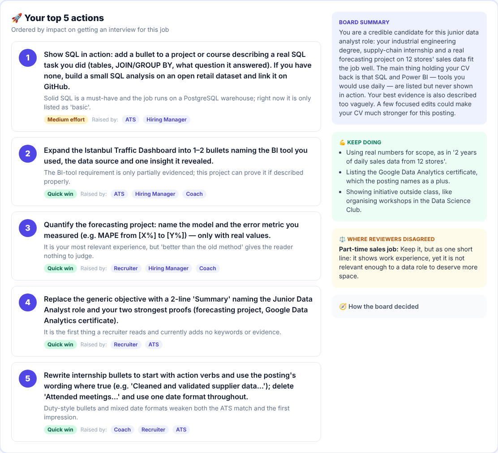
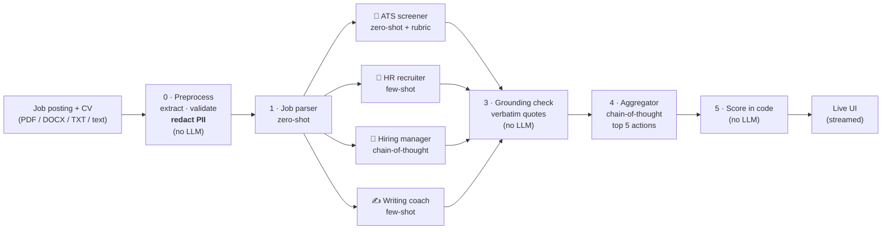
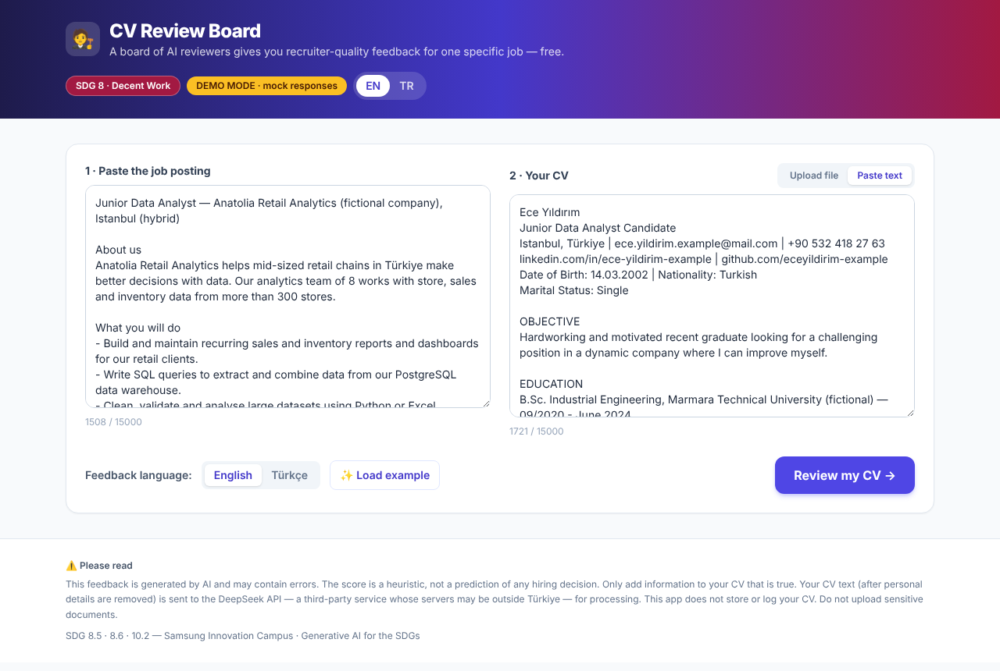
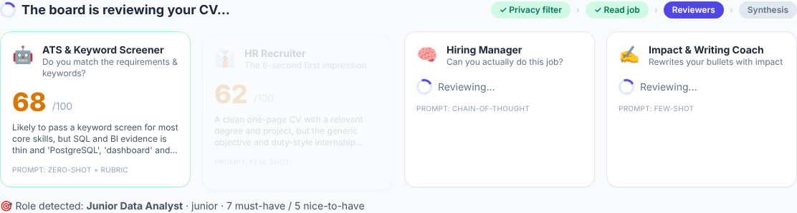
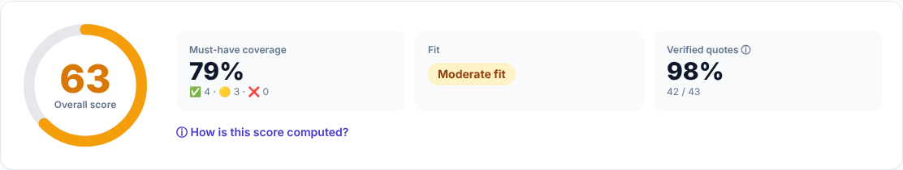
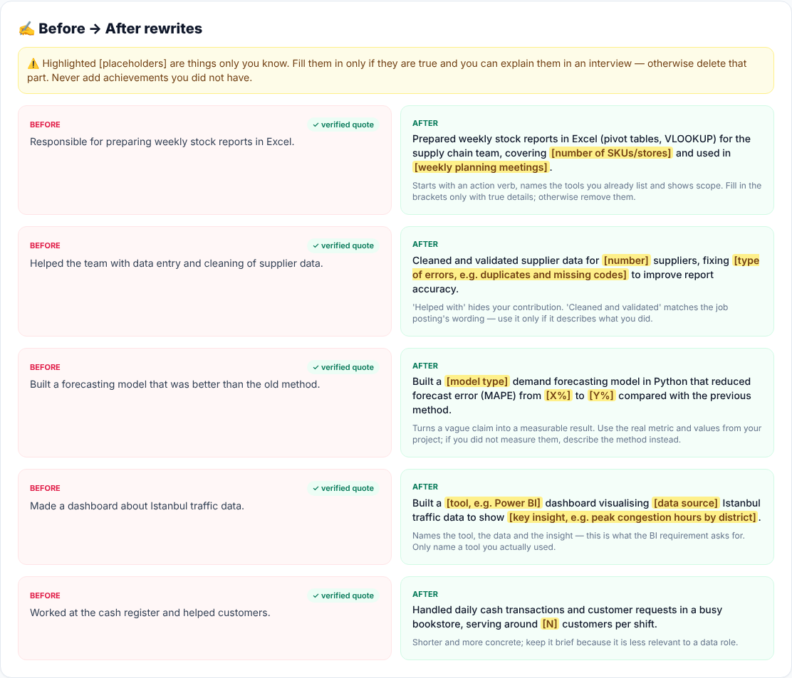
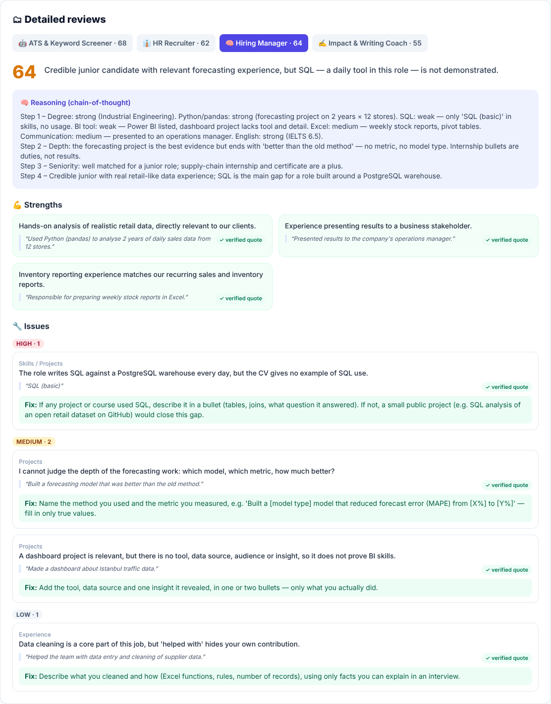

# 🧑‍⚖️ CV Review Board

**A board of specialised AI reviewers gives first-time job seekers recruiter-quality feedback on their CV — for one specific job posting, in Turkish or English, for free.**

> **Team 10** · Samsung Innovation Campus · *Generative AI for the SDGs* hackathon
> **SDG 8 — Decent Work and Economic Growth** (targets 8.5 & 8.6) · secondary **SDG 10.2** (inclusion)

You paste a job posting and upload your CV. Four AI "reviewer agents" — an **ATS screener**, an **HR recruiter**, a
**hiring manager** and a **writing coach** — evaluate the CV against *that* posting in parallel, each from a different
hiring perspective. A fifth **aggregator** agent merges their views into **one prioritised plan of at most five
actions**. Every quote is checked against your CV by code, personal data is removed before anything reaches the AI,
and the score is computed transparently in code — not by the model.



---

## Contents

- [Why — the SDG link](#why--the-sdg-link)
- [Quick start](#quick-start)
- [Deploy to Vercel](#deploy-to-vercel)
- [How it works](#how-it-works)
- [Prompt engineering](#prompt-engineering)
- [Ethics & safety](#ethics--safety)
- [About the score](#about-the-score)
- [Evaluation](#evaluation)
- [Screenshots](#screenshots)
- [Project structure](#project-structure)
- [Decisions & simplifications](#decisions--simplifications)
- [Team](#team)

---

## Why — the SDG link

**The problem.** Youth unemployment in Türkiye is roughly twice the overall rate, and a large share of young people
are *NEET* (not in employment, education or training) — among the highest NEET rates in the OECD
(see TÜİK labour-force statistics and the OECD *Education at a Glance* NEET indicator for current figures).
For a new graduate the first barrier is often not ability but the CV: it is filtered out by an applicant tracking
system or rejected in a 6-second recruiter scan, and the candidate never learns why. Professional CV reviews and
career coaches cost money, and good informal feedback depends on having a network — which first-generation
university students and young people outside big cities often do not have.

**What we do.** CV Review Board gives every young job seeker the kind of multi-perspective, job-specific feedback that
normally requires a career coach or a friend in HR: what the ATS will miss, what a recruiter sees first, whether a
hiring manager is convinced, and how to rewrite weak bullets — ranked by what matters most for getting an interview.

| SDG target | How the project contributes |
|---|---|
| **8.5** Full and productive employment and decent work for all, *including young people* | Helps new graduates and interns present their real skills effectively for the jobs they apply to. |
| **8.6** Substantially reduce the proportion of youth not in employment, education or training | Lowers a concrete barrier on the path from education to a first job: getting past screening to an interview. |
| **10.2** Empower and promote the social and economic inclusion of all | Free, recruiter-quality feedback for people without coaching budgets or professional networks; Turkish-language support; bias-reducing redaction of personal attributes. |

**Impact we expect** (a hypothesis, not a measured result): more first-time applicants passing keyword screening,
with CVs that state real evidence instead of generic duties. Next step would be a pilot with a university career
centre measuring interview-invitation rates before and after.

---

## Quick start

Requirements: **Python 3.11+**.

```bash
pip install -r requirements.txt
cp .env.example .env          # then put your DeepSeek key into .env (optional, see below)
uvicorn app.main:app --reload
```

Open **http://localhost:8000**, click **✨ Load example**, then **Review my CV →**.

| Variable | Default | Meaning |
|---|---|---|
| `DEEPSEEK_API_KEY` | – | DeepSeek API key. **Without it, the app runs in mock mode.** |
| `DEEPSEEK_MODEL` | `deepseek-chat` | Model name sent to the API. |
| `MOCK_LLM` | `0` | `1` = always use the pre-recorded fixtures in `samples/mock_responses/` (offline demo). |
| `DEEPSEEK_BASE_URL` | `https://api.deepseek.com` | Optional override (any OpenAI-compatible endpoint). |

**Mock mode** (no key or `MOCK_LLM=1`) returns realistic pre-recorded responses for the two sample CVs, with small
artificial delays so the live progress UI behaves like the real thing. A yellow **DEMO MODE** badge is shown. Use it
for offline development and as a fallback during a live demo.

Optional: `pip install pytest && pytest -q` runs the unit tests (redaction, grounding, scoring, schemas, prompts).

---

## Deploy to Vercel

**Live demo:** https://cv-review-board.vercel.app

The repo deploys to Vercel as-is. Vercel auto-detects the FastAPI app at `app/main.py`, and the config files are:

- `vercel.json`: allows a review up to 120 s (`maxDuration`) and keeps `docs/`, `tests/` and `scripts/` out of the function bundle. `static/`, `prompts/` and `samples/` must stay in, because the app reads them at runtime.
- `.python-version`: Python 3.12.
- `.vercelignore`: skips files that are not needed for the deployment.

**API key:** add `DEEPSEEK_API_KEY` (and optionally `DEEPSEEK_MODEL`) under *Project → Settings → Environment Variables*, then redeploy. Without it, the deployed app runs in demo mode with the pre-recorded sample responses.

**Limits:** Vercel caps request bodies at 4.5 MB, so CV uploads are limited to 4 MB. A review makes 6 LLM calls and took about 15 s in our test run.

> ⚠️ Once the key is set, anyone with the URL can spend your DeepSeek credits (the app has no login or rate limiting). Keep a low balance on the DeepSeek account during the hackathon.

---

## How it works



1. **Preprocess (local, no LLM)** — extracts text, validates length, and removes emails, phone numbers (incl. Turkish
   formats), TC Kimlik numbers, addresses, LinkedIn URL, the name, and lines with date of birth, age, marital status,
   gender, nationality, religion, military status, photo references, blood type etc. The user sees what was removed.
2. **Job parser** — turns the posting into `must_have` / `nice_to_have` requirements with ATS keywords.
3. **Four reviewers in parallel** (`asyncio`), each streamed to the UI the moment it finishes.
4. **Grounding check** — every quote must exist in the CV (exact or `rapidfuzz` ≥ 90); unverified quotes get a ⚠ badge.
   Numbers in rewrites that are not in the CV are flagged.
5. **Aggregator** — merges the four reports into ≤ 5 actions, ranked by interview impact, with "raised by" chips,
   effort level, conflicts and resolutions. It sees only the reviews, never the CV, so it cannot invent new claims.
6. **Deterministic score** — `overall = 0.35·HiringManager + 0.30·ATS + 0.20·Recruiter + 0.15·Coach`, plus
   must-have coverage = (met + 0.5·partial) / #must-haves.

Robustness: 60 s timeout, 2 retries with backoff on 429/5xx, one JSON-repair call, pydantic validation; if a reviewer
still fails, the others are shown and score weights are renormalised. Details: [docs/ARCHITECTURE.md](docs/ARCHITECTURE.md).

---

## Prompt engineering

All six prompts are human-readable files in [`/prompts`](prompts), each with a system part and a user template. Full
documentation — purpose, technique, rationale, design iteration and full text — is in **[docs/PROMPTS.md](docs/PROMPTS.md)**.

| Prompt | Technique | Why this technique |
|---|---|---|
| Job parser | **Zero-shot**, strict schema, T=0.2 | Well-defined extraction; examples would bias the domain. |
| ATS screener | **Zero-shot + explicit rubric** (met/partial/missing) | Mechanical classification: consistency over creativity. |
| HR recruiter | **Few-shot**, contrastive *vague vs. specific* findings | The hard part is the *specificity* of feedback, which examples teach best. |
| Hiring manager | **Chain-of-thought** in an `analysis` field placed first | Weighing scattered evidence against requirements is multi-step reasoning; the verdict is conditioned on it. |
| Writing coach | **Few-shot** before/after (incl. Turkish) + no-fabrication rule | Style transfer is specified best by examples; examples also demonstrate `[placeholders]`. |
| Aggregator | **Chain-of-thought** (agree → conflicts → rank) | Synthesis of four reports requires comparing and resolving. |

Shared across every prompt: role/persona · exact JSON schema (DeepSeek JSON mode) · *quote verbatim* · *never invent* ·
*be specific to THIS posting* · `<cv>` / `<job_posting>` delimiters with a data-not-instructions rule (prompt-injection
defence) · fairness instruction · constructive tone for first-time job seekers · `{output_language}` (TR/EN) with
English JSON keys · 0–100 score anchors.

---

## Ethics & safety

Full risk → mitigation table: **[docs/ETHICS.md](docs/ETHICS.md)**. In short:

- 🧾 **Hallucination** → verbatim-quote grounding check in code + visible verification rate; unverified items are flagged, not hidden.
- 🚫 **Fabricated achievements** → no-invention rule, `[placeholders]` highlighted in the UI, code check for numbers not in the CV.
- ⚖️ **Bias** → protected attributes redacted *before* the API call + fairness instruction in every reviewer.
- 🔒 **Privacy / KVKK** → PII redaction, no storage, no content logging. **DeepSeek is a third-party API whose servers may
  be outside Türkiye** — do not upload sensitive documents. The UI shows exactly what text was sent.
- 📉 **Over-reliance on the score** → formula and breakdown visible, heuristic disclaimer, action plan is the hero.
- 🎯 **Keyword stuffing** → "add a keyword only if you genuinely have the skill", repeated in prompts and UI.
- 💉 **Prompt injection** → delimiters + data-not-instructions rule, single-pass templating, HTML-escaped output.
- 🌍 **Language parity** → Turkish examples and cue words, TR + EN samples evaluated.

---

## About the score

The overall score is a **heuristic** for *how well this CV presents you for this specific posting*. It is **not** a
prediction of whether you will be hired, and it is computed in [`app/scoring.py`](app/scoring.py), not by the LLM:

```
overall = 0.35 · Hiring Manager + 0.30 · ATS + 0.20 · Recruiter + 0.15 · Coach
must-have coverage = (met + 0.5 · partial) / number of must-have requirements
```

The hiring manager has the highest weight because evidence of ability matters most; the coach the lowest because
writing quality is the easiest thing to fix. If a reviewer fails, its weight is redistributed and the UI says so.

---

## Evaluation

`python scripts/evaluate.py` runs both sample pairs twice against the real model and writes [docs/EVALUATION.md](docs/EVALUATION.md). Latest run (DeepSeek `deepseek-chat`):

- **Grounding:** 210 of 210 quoted excerpts verified in the CV.
- **Fabrication check:** no rewrite contained a number missing from the CV; 29 `[placeholders]` used instead.
- **Consistency:** overall score varied by 5 points (EN) and 2 points (TR) between identical runs; the Recruiter is the least stable reviewer.
- **Speed:** 16–25 s per review.

`python scripts/ablations.py` tests each prompt against a baseline with its key technique removed ([docs/ABLATIONS.md](docs/ABLATIONS.md)). The clearest effects: without the no-invention rule the Coach invented numbers in 5 of 20 rewrites (0 with it), and without the attribute ban the job parser turned "male candidate", age and marital-status filters into requirements (none with it).

---

## Screenshots

| | |
|---|---|
| **Input** — job posting, CV upload/paste, TR/EN toggle, example loader  | **Live progress** — each reviewer card fills in as it finishes  |
| **Score** — overall, must-have coverage, fit, verified quotes  | **Before → after** — `[placeholders]` highlighted, never invented  |
| **Per-agent detail** — issues by severity, verified quote badges, chain-of-thought reasoning  | **Top 5 actions** — the hero section  |

_Screenshots taken in mock mode with the English sample._

---

## Project structure

```
├── app/
│   ├── main.py         # FastAPI app, routes, NDJSON streaming
│   ├── llm.py          # DeepSeek client: retries, timeout, JSON parse + 1 repair retry, mock mode
│   ├── pipeline.py     # preprocess → job parse → parallel agents → grounding → aggregate → score
│   ├── preprocess.py   # text extraction, PII / personal-attribute redaction, validation
│   ├── grounding.py    # verifies quoted evidence exists in the CV; new-number check
│   ├── scoring.py      # deterministic overall score
│   ├── schemas.py      # pydantic models for every LLM output
│   └── prompts.py      # loads prompt templates from /prompts
├── prompts/            # every prompt as a .md file (system + user template)
├── static/index.html   # single-page UI (vanilla JS + Tailwind CDN)
├── samples/            # fictional TR + EN junior CVs, 2 job postings, mock_responses/{en,tr}/*.json
├── scripts/
│   ├── evaluate.py           # consistency / grounding / fabrication metrics → docs/EVALUATION.md
│   └── build_prompts_doc.py  # regenerates docs/PROMPTS.md from /prompts
├── tests/test_core.py  # unit tests for the non-LLM parts
├── docs/               # PROMPTS.md · ETHICS.md · ARCHITECTURE.md · EVALUATION.md · screenshots/
├── .env.example
└── requirements.txt
```

All sample CVs, people, companies and universities are **fictional**.

---

## Decisions & simplifications

Decisions we made without asking (hackathon speed):

- **One language toggle** controls both the UI language and the feedback language.
- **The name is redacted too** (first-line heuristic), and LinkedIn URLs, because both identify the person and can
  trigger bias. GitHub/portfolio links are kept because they are job-relevant evidence.
- **Redaction markers are typed** (`[REDACTED: phone]` rather than a bare `[REDACTED]`), so reviewers know the
  information existed and do not flag "missing contact details".
- **The aggregator receives a compact, quote-free view** of the reviews (with `verified` flags) — fewer tokens, smaller
  injection surface, and it cannot add claims about the CV.
- **Job parser failure is not fatal**: reviewers fall back to the raw posting text and the UI shows a warning.
- **Mock fixtures are chosen by CV language** (Turkish characters → TR set). With a non-sample CV in mock mode, quotes
  will not match and are shown as unverified — the UI explains this.
- An extra `GET /api/health` endpoint tells the UI whether it runs in mock mode, and the UI offers "show exactly what
  the AI saw" (the redacted CV) for transparency.
- Streaming uses newline-delimited JSON over a `StreamingResponse` (SSE-style events, simpler to POST multipart).

Simplified / not done:

- No OCR: scanned (image-only) PDFs produce a clear error asking the user to paste text.
- Redaction is regex/heuristic-based, not NER; see residual risks in ETHICS.md.
- No user accounts, history or persistence (by design, for privacy).
- No rate limiting or auth on the API — fine for a local demo, required before any public deployment.

---

## Team

**Team 10**

| Name | Role | Owns | Contact |
|---|---|---|---|
| Sefa Berk Acar | Project lead · backend & pipeline | `app/` (pipeline, LLM client, streaming API), Vercel deployment, [ARCHITECTURE.md](docs/ARCHITECTURE.md) | acarsefa621@gmail.com |
| Umut Öztürk | Prompt engineering lead | [`prompts/`](prompts), [PROMPTS.md](docs/PROMPTS.md), prompt-design section of [DOCUMENTATION.md](docs/DOCUMENTATION.md) | umtozturk2003@gmail.com |
| Hikmet Mete Çelik | Frontend & demo video | [`static/index.html`](static/index.html) (UI, TR/EN strings), screenshots, demo video | hmetecelik33@gmail.com |
| Betül Kaya | Ethics, privacy & safety | Redaction rules ([`app/preprocess.py`](app/preprocess.py)), grounding check, [ETHICS.md](docs/ETHICS.md) | kayabetul094@gmail.com |
| Yaşar Kaan Can | Evaluation, SDG research & presentation | [`scripts/evaluate.py`](scripts/evaluate.py), samples, [EVALUATION.md](docs/EVALUATION.md), SDG section, report & slides | ycan25@ku.edu.tr |

Built with FastAPI, httpx, pydantic, rapidfuzz, pypdf, python-docx, Tailwind CSS and the DeepSeek API.
