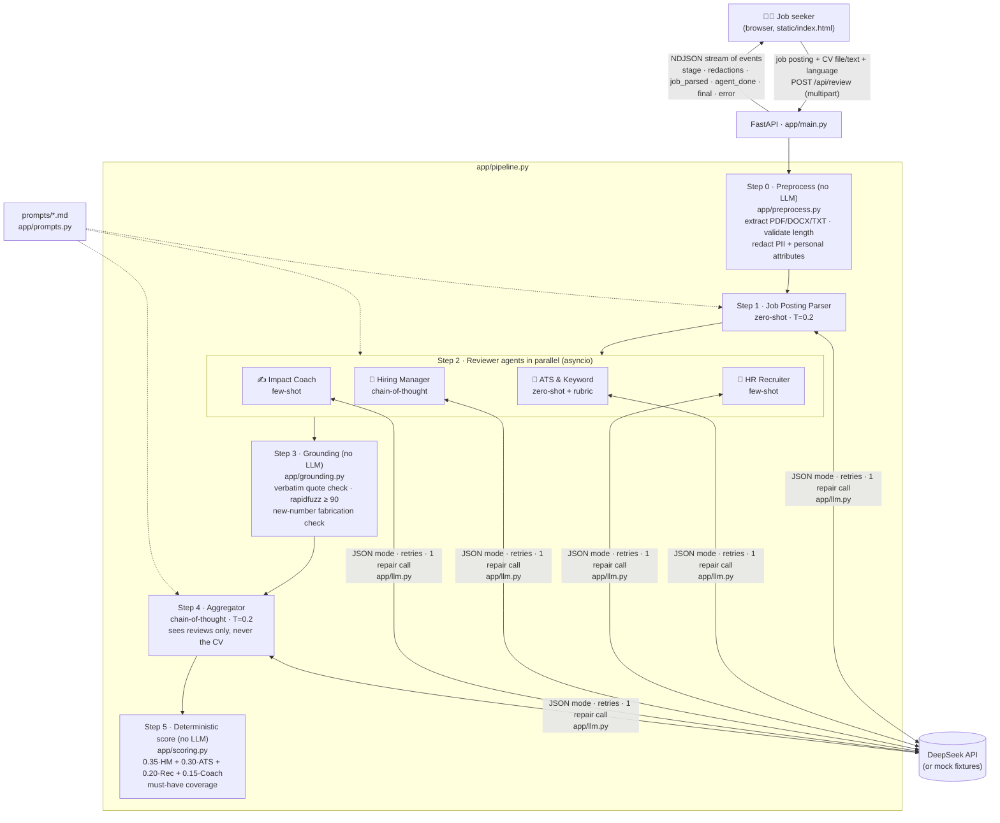

# Architecture



## Components

| File | Responsibility |
|---|---|
| `app/main.py` | Routes: `GET /` (UI), `GET /api/health`, `GET /api/samples`, `POST /api/review` (streaming NDJSON). |
| `app/pipeline.py` | Orchestration. Runs the 4 reviewers with `asyncio.create_task` + `asyncio.as_completed`, so each `agent_done` event is streamed the moment that agent finishes. One failed agent never stops the others. |
| `app/llm.py` | DeepSeek client on raw `httpx`: 60 s timeout, 2 retries with exponential backoff on 429/5xx/network errors, JSON parsing (tolerates code fences), pydantic validation, one repair call on invalid JSON/schema. Mock mode when `MOCK_LLM=1` or no key. Logs metadata only, never content. |
| `app/preprocess.py` | Text extraction (pypdf, python-docx incl. tables, TXT with cp1254 fallback), validation (CV ≥ 300, job ≥ 150, ≤ 15 000 chars), regex redaction (emails, TR/intl phones, TC Kimlik, addresses, LinkedIn URL, name heuristic, and labelled personal-attribute fields in TR and EN). |
| `app/grounding.py` | Verifies each quoted `evidence` / rewrite `original` against the redacted CV (normalise → exact substring → `rapidfuzz.partial_ratio ≥ 90`). Flags, never drops. Detects numbers in rewrites that are not in the CV. |
| `app/scoring.py` | Weighted overall score and must-have coverage, in code. Weights are renormalised if an agent failed. |
| `app/schemas.py` | Pydantic models for every LLM output; lenient input normalisation (case, enum aliases, score clamping, max 5 actions). |
| `app/prompts.py` | Loads `prompts/*.md`, single-pass placeholder substitution. |
| `static/index.html` | Single page, vanilla JS + Tailwind CDN. Reads the stream with `fetch` + `ReadableStream`, renders live agent cards, results, Markdown report export. All LLM text is HTML-escaped before rendering. |

## Event stream (`POST /api/review`)

One JSON object per line:

```json
{"type":"stage","stage":"preprocess"}
{"type":"redactions","items":[{"kind":"date_of_birth","label":"date of birth","count":1}],"cv_redacted":"..."}
{"type":"stage","stage":"parse_job"}
{"type":"job_parsed","job":{...}}
{"type":"stage","stage":"agents"}
{"type":"agent_done","agent":"ats","ok":true,"result":{...},"verification":{"checked":18,"verified":18,"rate":1.0}}
{"type":"agent_done","agent":"coach","ok":false,"error":"..."}
{"type":"stage","stage":"aggregate"}
{"type":"final","result":{"job":{},"agents":{},"agent_errors":{},"aggregate":{},"scores":{},"verification":{},"redactions":[]}}
{"type":"error","message":"..."}
```

## Latency & cost

One review = 6 LLM calls (1 parser + 4 parallel reviewers + 1 aggregator), so wall-clock time ≈ parser + slowest
reviewer + aggregator. Each reviewer request is roughly 3–5k input tokens for a one-page CV. `scripts/evaluate.py`
records the real wall-clock time per run in `docs/EVALUATION.md`.
