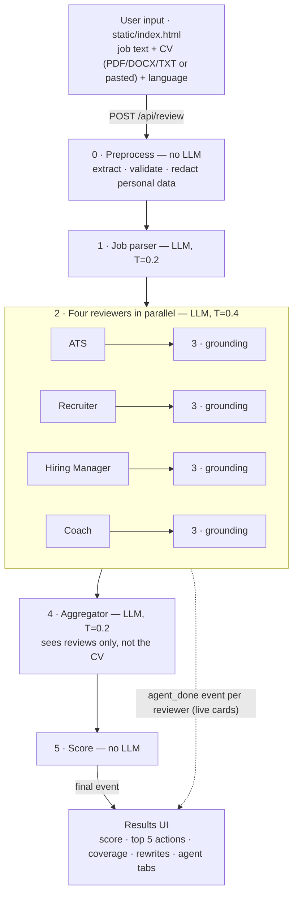

# CV Review Board — Technical Documentation

**Team 10** · Samsung Innovation Campus · *Generative AI for the SDGs*

**Team:** Sefa Berk Acar (project lead · backend & pipeline) · Umut Öztürk (prompt engineering lead) · Hikmet Mete Çelik (frontend & demo video) · Betül Kaya (ethics, privacy & safety) · Yaşar Kaan Can (evaluation, SDG research & presentation)

## 1. Overview

CV Review Board reviews a CV against **one specific job posting**. Four specialised LLM reviewer agents evaluate the CV in parallel from different hiring perspectives, and an aggregator merges their findings into at most five prioritised actions. It is built for young and first-time job seekers in Türkiye who lack access to career coaching, and it works in Turkish and English. It addresses **SDG 8**, targets **8.5** (productive employment, including for young people) and **8.6** (reducing youth not in employment, education or training).

## 2. How it works

**0 · Preprocess** (`app/preprocess.py`, no LLM). Extracts text from PDF, DOCX or TXT and rejects CVs under 300 characters, postings under 150, inputs over 15,000 characters and files over 4 MB. Regex rules replace personal data with markers like `[REDACTED: phone]`: contact details, TC Kimlik numbers, addresses, the name (heuristic), and labelled fields such as date of birth, marital status, nationality or military status, in TR and EN. Output: the redacted CV plus a list of removals shown to the user.

**1 · Job parser** (LLM). Turns the posting into `must_have` / `nice_to_have` requirements with ATS keywords. If it fails, reviewers use the raw posting.

**2 · Reviewers** (LLM). Each gets the parsed job, the raw posting and the redacted CV, and returns `score`, `verdict`, `strengths`, `issues` and agent-specific fields. The calls run concurrently (`asyncio.as_completed`), and each result streams to the UI when ready.

**3 · Grounding** (`app/grounding.py`, no LLM). Every quoted `evidence` and rewrite `original` is matched against the redacted CV: normalised exact substring, then `rapidfuzz.partial_ratio ≥ 90`. Items are flagged `verified: true/false`, never dropped, and a verification rate is computed. Numbers in rewrites that are not in the CV are flagged.

**4 · Aggregator** (LLM). Receives a quote-free view of the reviews with their `verified` flags, and returns a summary, fit assessment, up to five `top_actions`, conflicts and strengths to keep. Code enforces the limit of five actions.

**5 · Score** (`app/scoring.py`, no LLM). `overall = 0.35·Hiring Manager + 0.30·ATS + 0.20·Recruiter + 0.15·Coach`; `must-have coverage = (met + 0.5·partial) / number of must-haves`, taken from the ATS output.

**Streaming, errors, mock mode.** `POST /api/review` streams newline-delimited JSON events, and the UI fills each reviewer card live. LLM calls have a 60 s timeout and 2 retries with backoff on 429, 5xx and network errors. If an agent still fails, the others' results are shown and the score weights are renormalised; if the aggregator fails, the individual reviews remain. With `MOCK_LLM=1` or no API key, pre-recorded responses are returned for offline demos.

## 3. The agents

| Agent | Question it answers | Technique | Temp. | Key output fields |
|---|---|---|---|---|
| Job parser | What does this posting require? | Zero-shot, strict schema | 0.2 | `must_have`, `nice_to_have`, `seniority` |
| ATS & Keyword Screener | Would an automated screen find the requirements? | Zero-shot + rubric | 0.4 | `requirement_coverage`, `missing_keywords` |
| HR Recruiter | What does a recruiter see in 6 seconds? | Few-shot | 0.4 | `strengths`, `issues` |
| Hiring Manager | Does the evidence show this person can do the job? | Chain-of-thought | 0.4 | `analysis` (first), `score`, `issues` |
| Impact & Writing Coach | How should the weakest bullets read? | Few-shot | 0.4 | `rewrites` (`original`, `improved`, `why`) |
| Aggregator | What should the candidate do first? | Chain-of-thought | 0.2 | `reasoning` (first), `top_actions`, `conflicts` |

JSON repair calls use temperature 0.0.

## 4. Prompt design

Full prompts are in [`/prompts`](../prompts); excerpts are verbatim. Each **baseline test** compares the final prompt with a version missing its key technique (same model, temperature, schema and inputs; 2–3 runs; full results in [ABLATIONS.md](ABLATIONS.md)).

### 4.1 Job parser — [`job_parser.md`](../prompts/job_parser.md)
- **Goal:** a structured requirement list that all reviewers share.
- **Technique and why:** zero-shot. Extraction is well defined, and an example posting would bias output towards its domain, so precise must/nice rules replace examples.
- **Key decisions:** split compound requirements; low temperature; personal attributes in a posting never become requirements.
- **Excerpt:** *"Do NOT extract personal attributes such as age, gender, marital status, military service or nationality as requirements, even if the posting mentions them."*
- **Baseline test:** without rules 2–8, the parser still sorted the Turkish posting's 4 optional items correctly, so the cue-word rules made no measurable difference there. The attribute ban did: on a fictional posting with discriminatory filters, the baseline listed "Erkek aday", "Askerliğini tamamlamış", "28 yaşını geçmemiş" and "Bekar" as requirements in both runs; the final prompt listed none.

### 4.2 ATS & Keyword Screener — [`ats_screener.md`](../prompts/ats_screener.md)
- **Goal:** mark each requirement met, partial or missing.
- **Technique and why:** zero-shot with an explicit rubric. Mechanical classification needs consistency, which a precise three-level definition with score anchors gives better than examples.
- **Key decisions:** one row per requirement; verbatim evidence or `""`; missing-keyword fixes say "only if you genuinely have the skill".
- **Excerpt:** *"partial" = related but weaker evidence: the keyword appears only in a skills list with no usage, OR a closely related skill is shown …*
- **Baseline test:** without the rubric, Power BI (listed under Skills only) was rated `met` in 2 of 3 runs; with the rubric it was `partial` in all 3, as defined. Requirements with the same status in all 3 runs rose from 77% to 92%.

### 4.3 HR Recruiter — [`hr_recruiter.md`](../prompts/hr_recruiter.md)
- **Goal:** judge first impression, structure, clarity and red flags.
- **Technique and why:** few-shot with contrastive pairs. The hard part is feedback *specificity*; each pair shows a VAGUE and a SPECIFIC version of one finding, from a different fictional CV, so the model copies the pattern, not the content.
- **Key decisions:** quote, explain, give a quick fix; never suggest adding a photo or personal details.
- **Excerpt:** *"The pattern: quote the exact text, explain WHY it hurts for THIS job, and give a fix the candidate can apply in minutes."*
- **Design change:** while writing the ethics assessment we noticed the prompt listed "unexplained gaps" as a red flag without guidance on how to treat them. We added: *"suggest a short, honest one-line explanation — a gap is never a disqualifier on its own"*.
- **Baseline test:** removing the examples changed less than expected: issues quoted the CV equally often (93%), but fixes got shorter (27 vs. 32 words on average). The model is already fairly specific without examples; the examples mainly add detail to the fixes.

### 4.4 Hiring Manager — [`hiring_manager.md`](../prompts/hiring_manager.md)
- **Goal:** decide whether the evidence shows the ability to do this job at this level.
- **Technique and why:** chain-of-thought. Weighing requirements against scattered evidence is multi-step reasoning; the `analysis` field comes *first* in the JSON, so score and issues are generated after it.
- **Key decisions:** four fixed steps, about 150 words maximum; parsed seniority inserted via `{seniority_hint}`; "the CV fails to show" is kept distinct from "the candidate lacks".
- **Excerpt:** *"Step 4 — Only now decide the score and the issues, consistent with steps 1–3."*
- **Baseline test:** removing the `analysis` field did not make scores less stable (baseline 72, 72, 72; final 68, 68, 72). We keep chain-of-thought for transparency, because the reasoning is shown to the user, not for consistency.

### 4.5 Impact & Writing Coach — [`impact_coach.md`](../prompts/impact_coach.md)
- **Goal:** rewrite the 3–5 weakest bullets as action + what + measurable result.
- **Technique and why:** few-shot. Rewriting is style transfer, best specified by before/after examples, which also demonstrate placeholders; one example is Turkish.
- **Key decisions:** a HARD RULE against inventing facts; verbatim `original` so it can be grounded; code flags any new number in `improved`.
- **Excerpt:** *"When a metric would make the bullet stronger but the CV does not give it, insert a placeholder in square brackets, such as [X%], [number of users], [N kişi] …"*
- **Baseline test:** without the HARD RULE and the placeholder examples, 5 of 20 rewrites contained numbers found nowhere in the CV (e.g. "günlük 50+ müşteriye", "5 rakip markanın") and none used placeholders. With the final prompt: 0 invented numbers and 27 placeholders in 20 rewrites.

### 4.6 Aggregator — [`aggregator.md`](../prompts/aggregator.md)
- **Goal:** at most five actions, ranked by impact on getting an interview.
- **Technique and why:** chain-of-thought. Synthesis means merging duplicates and resolving reviewer conflicts; the `reasoning` field (agreement → conflicts → ranking) comes first.
- **Key decisions:** multi-reviewer issues rank higher; findings that rest only on unverified quotes get caution; the CV is never sent to this agent.
- **Excerpt:** *"DO NOT INTRODUCE NEW CLAIMS: every action, conflict and keep_doing item must come from at least one reviewer's report."*
- **Baseline test:** without the reasoning steps and ranking rules, the aggregator returned 9 and 8 actions instead of at most 5, and merged duplicates less (2.8 vs. 3.4 reviewers credited per action).

## 5. Cross-cutting prompt principles

- **Injection defence:** user content sits inside `<cv>`, `<job_posting>` and similar tags, declared as data, with a reminder after the untrusted text. Placeholders are filled in one regex pass, so text containing `{cv_text}` cannot pull in other content. This replaced sequential string replacement during development.
- **Bias:** every reviewer has a FAIRNESS rule (ignore name, gender, age, nationality, religion, marital/military status, photo, university prestige), backed by Step 0 redaction.
- **JSON mode + repair:** every call uses `response_format: json_object`, and every prompt contains the exact schema and the word "json". Output is validated with pydantic; on failure, one repair call asks for valid JSON only.
- **Reasoning before the answer:** chain-of-thought lives in `analysis` / `reasoning` fields placed first, so it shapes the verdict while the output stays parseable.
- **Score in code:** reviewers score against anchored rubrics, but the overall score is a fixed formula shown in the UI, so no single model output, including an injected "100", controls it.
- **Shared rules:** quote verbatim, never invent, be specific to THIS posting; `{output_language}` (TR/EN) for values.

## 6. Reliability and safety

Personal data is redacted before any API call; unverified quotes carry a ⚠ badge next to an overall verification rate; rewrites use highlighted `[placeholders]` instead of invented numbers; nothing is stored or logged beyond metadata. Full risk table: [ETHICS.md](ETHICS.md).

`scripts/evaluate.py` ran each sample twice against DeepSeek `deepseek-chat` ([EVALUATION.md](EVALUATION.md)): 210 of 210 quoted excerpts were verified in the CV, no rewrite contained a number missing from the CV (29 placeholders used), and the overall score varied by 5 points (EN) and 2 points (TR) between identical runs. A review takes 16–25 s. The least stable reviewer is the Recruiter (14-point spread on the EN CV).

## 7. Limitations

- The score is a heuristic for one posting, not a hiring prediction; the weights are unvalidated design choices.
- Only extracted text is analysed, not visual layout; scanned PDFs without a text layer cannot be read.
- A verified quote proves the text exists in the CV, not that the reviewer interpreted it correctly.
- Regex redaction can miss unusual formats. Turkish and English results look comparable on our two samples, but two samples are not a broad test.
- Redacted CV text is sent to the DeepSeek API, a third-party service whose servers may be outside Türkiye.

## 8. How to run

**Live demo:** https://cv-review-board.vercel.app · **Local:** `pip install -r requirements.txt`, then `uvicorn app.main:app --reload` and open http://localhost:8000. Add `DEEPSEEK_API_KEY` to `.env`; without it the app runs in mock mode. Details: [README](../README.md).
